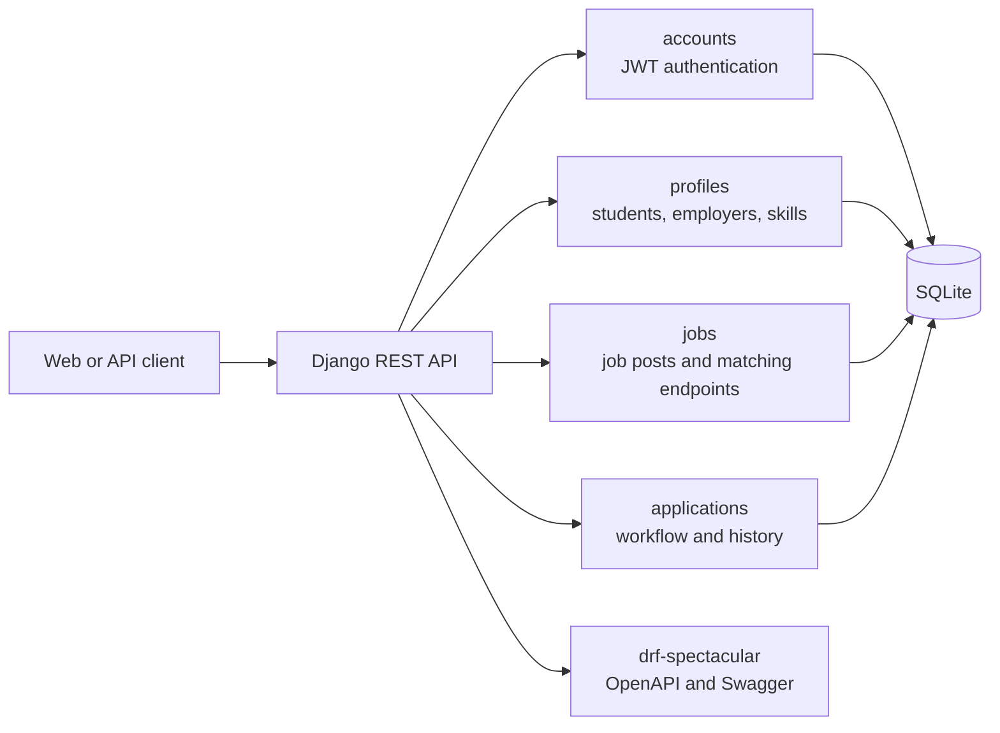
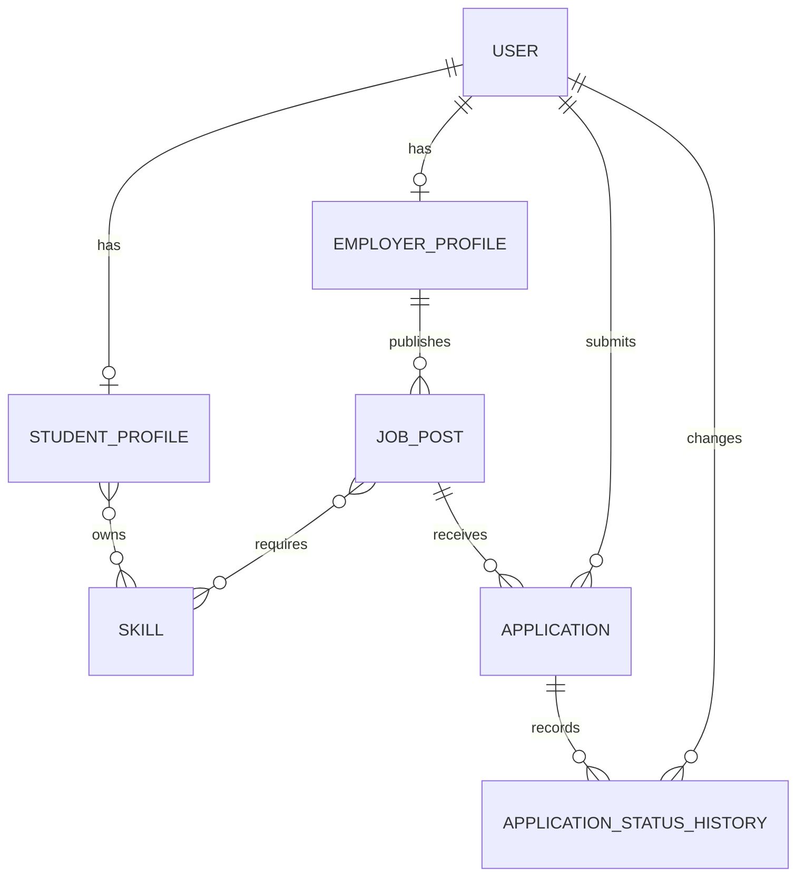

# EdFin Talent Connect

[](https://github.com/codesbysoumik/edfin-talent-connect/actions/workflows/ci.yml)

EdFin Talent Connect is a Django REST API for connecting university students with internships and jobs. It is the Campus Talent Connect Portal module of the EdFin project, with role-based access for students, employers, and admins. The live demo is not deployed yet: **Live URL: [placeholder](#)**.

## Features

- Email-based JWT registration and login for students and employers.
- Student profiles, employer profiles, skills, and validated PDF resumes.
- Verified-employer job posting with filtering, search, ordering, and pagination.
- Job applications with ownership permissions, status transitions, and history.
- Explainable skill matching with a CGPA eligibility gate.
- Swagger UI and an OpenAPI schema.
- Faker-powered demo data and GitHub Actions CI.

## Tech stack

| Area | Technology |
| --- | --- |
| Backend | Django 6.1.2, Django REST Framework 3.18.3 |
| Authentication | `djangorestframework-simplejwt` |
| Filtering | `django-filter` |
| API documentation | `drf-spectacular` |
| Development database | SQLite |
| Tests and lint | pytest, pytest-django, Ruff |
| Demo data | Faker |
| CI | GitHub Actions |

## Architecture



## ER diagram



## API overview

All application endpoints are under `/api/v1/`.

| Area | Endpoints |
| --- | --- |
| Auth | `POST /auth/register/`, `POST /auth/login/`, `POST /auth/refresh/`, `GET /auth/me/` |
| Jobs | `GET/POST /jobs/`, `GET/PATCH/PUT/DELETE /jobs/{id}/` |
| Applications | `POST /jobs/{id}/apply/`, `GET /applications/`, `GET /applications/{id}/` |
| Application workflow | `PATCH /applications/{id}/status/`, `GET /applications/{id}/history/` |
| Matching | `GET /jobs/recommended/`, `GET /jobs/{id}/matches/` |
| Documentation | `GET /api/schema/`, Swagger UI at `/api/docs/` |

Job lists support `job_type`, `location`, and `skill` filters, title search, ordering, and page-number pagination. Protected endpoints use the JWT bearer token from the login response.

## Run locally

On Windows with the project virtual environment:

```bash
python -m venv .venv
source .venv/Scripts/activate
python -m pip install -r requirements.txt
python manage.py migrate
python manage.py seed_demo_data
python manage.py runserver
```

Then open:

- API: <http://127.0.0.1:8000/api/v1/>
- Swagger UI: <http://127.0.0.1:8000/api/docs/>
- OpenAPI schema: <http://127.0.0.1:8000/api/schema/>

## Tests and lint

```bash
pytest
ruff check .
```

## Demo credentials

The seed command creates or updates these fixed accounts:

| Role | Email | Password |
| --- | --- | --- |
| Student | `student@demo.com` | `DemoPass123!` |
| Employer | `employer@demo.com` | `DemoPass123!` |
| Admin | `admin@demo.com` | `DemoPass123!` |

All demo employers are verified. Running `python manage.py seed_demo_data` again reuses the deterministic demo users, profiles, jobs, and applications instead of duplicating them.

## Matching algorithm

Matching is intentionally transparent: the service compares the student's skills with the job's required skills, returns the matched and missing skill names, and scores required-skill coverage as `matched required skills / total required skills * 100`. Extra student skills do not lower the score. A job with no required skills scores 100 for an eligible student. If the student's CGPA is below the job's minimum, the score is 0 while the skill explanation remains available.

## Roadmap

- Celery email notifications for applications and status changes.
- Admin API endpoints for employer verification and platform statistics.
- Docker and PostgreSQL deployment configuration.
- Production deployment with Gunicorn, nginx, HTTPS, and environment-based settings.

The project does not currently claim these roadmap features as implemented.

## Paper context

This project is the Campus Talent Connect Portal module from the EdFin paper context. Add the published paper URL here when it is available.
